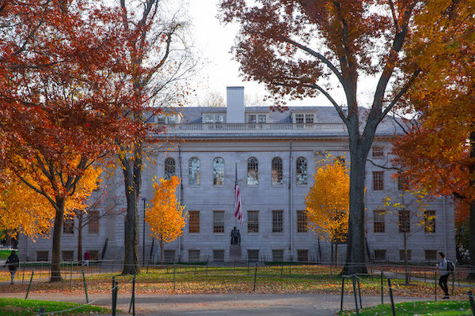

# Image Filters in C

A command-line BMP image filter written in C (CS50 Problem Set 4, Filter - Less). It applies one of four filters to a 24-bit BMP file by working directly on the pixel array.

## Usage

```
make filter
./filter -g images/yard.bmp out/greyscale.bmp   # greyscale
./filter -s images/yard.bmp out/sepia.bmp       # sepia
./filter -r images/yard.bmp out/reflect.bmp     # reflect
./filter -b images/yard.bmp out/blur.bmp        # blur
```

## Results

| Original | Greyscale |
|---|---|
|  |  |

| Sepia | Reflect | Blur |
|---|---|---|
|  |  |  |

> Browsers don't display `.bmp` reliably, so the images above are PNG conversions of the BMP files.

## How each filter works

- **Greyscale**: each pixel's red, green and blue are replaced by their average, rounded. The sum is divided by `3.0` so the division is not truncated.
- **Sepia**: each pixel's original values go through the standard sepia formulas. Each result is rounded and capped at 255.
- **Reflect**: each row is mirrored left to right by swapping pixels in place, stopping at the halfway point.
- **Blur**: each pixel becomes the average of the 3x3 box around it. Neighbours outside the image are skipped, so edges and corners average fewer pixels. The averages are read from a **copy** of the image so already-blurred pixels never feed into later ones.

## The read-from-a-copy problem

Blurring in place makes each pixel average against neighbours that were already blurred, which smears the picture. Reading from an untouched copy and writing to the original avoids this. The same idea applies to any grid update, such as Game of Life.

## Files

- `helpers.c`: the four filter functions (my work)
- `filter.c`, `bmp.h`, `helpers.h`, `Makefile`: provided by CS50

## Check

`check50 cs50/problems/2025/x/filter/less` passes all checks (screenshot in the project PDF).
